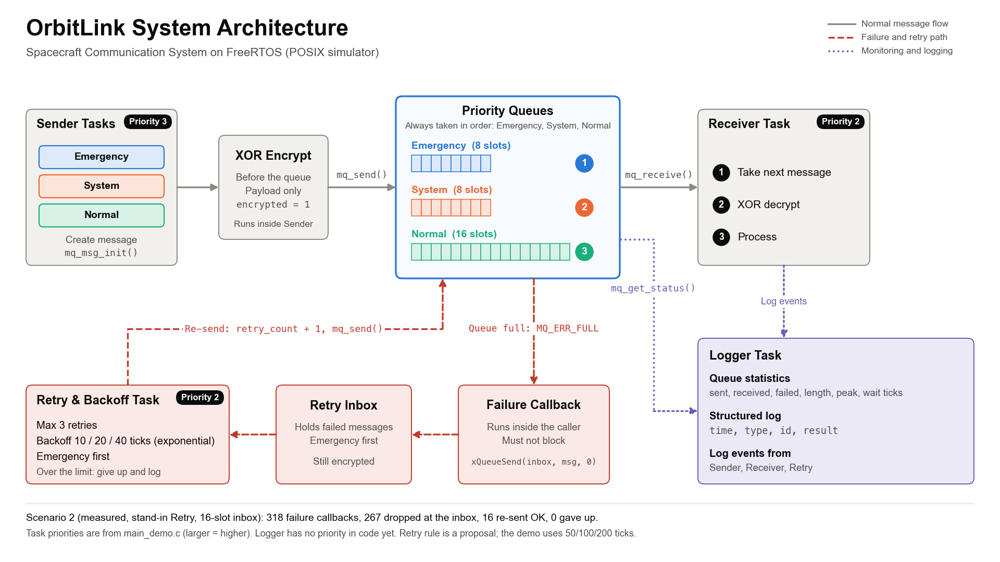

# OrbitLink 전체 구조도 설명

11/10 제안 발표용 자료입니다. 그림은 `전체구조도.png`이고, `python3 docs/설계/tools/make_architecture.py`로 다시 만들 수 있습니다.



**한 문장 요약:** Sender가 만든 메시지를 암호화해서 우선순위 큐에 넣고, Receiver는 항상 Emergency부터 꺼내 복호화합니다. 큐가 가득 차서 못 넣은 메시지는 Retry가 다시 보내고, Logger가 이 모든 과정을 기록합니다.

**읽기 전에 구분할 것**

| 구분 | 내용 |
|---|---|
| 지금 코드에 있음 | 우선순위 큐 3개, 실패 콜백, 통계(`mq_get_status`). `msg_queue.c`가 실제 구현입니다. |
| 데모용으로만 있음 | Sender, Receiver, Retry, Monitor. `main_demo.c`의 가짜 태스크입니다. |
| 이번 제안 | XOR 암호화와 복호화, Logger 태스크, Retry 규칙(10/20/40 tick, Emergency 우선). 아직 코드에 없습니다. |

## 1. 블록별 역할

그림의 `Priority` 숫자는 `main_demo.c`에 적힌 FreeRTOS 태스크 우선순위입니다. 숫자가 클수록 먼저 CPU를 받습니다.

| 블록 | 역할 | 태스크 우선순위 |
|---|---|---|
| Sender Tasks | Emergency, System, Normal 메시지를 만듭니다. `mq_msg_init()`이 id, seq, timestamp를 채웁니다. | 3 |
| XOR Encrypt | `payload`만 암호화하고 `encrypted = 1`로 표시합니다. | 없음. 태스크가 아니라 Sender 안에서 실행 |
| Priority Queues | Emergency 8칸, System 8칸, Normal 16칸. 꺼낼 때마다 Emergency 큐부터 다시 확인합니다. | 없음. 태스크가 아님 |
| Receiver Task | 메시지를 꺼내 XOR로 복호화하고 처리합니다. 메시지가 없으면 카운팅 세마포어에서 잠듭니다. | 2 |
| Failure Callback | 큐가 가득 찼을 때 실패한 메시지를 Retry 대기함에 복사합니다. 기다리면 안 됩니다. | 없음. `mq_send()`를 부른 태스크 안에서 실행 |
| Retry Inbox | 재전송을 기다리는 메시지를 보관하는 FreeRTOS 큐입니다. 데모는 16칸입니다. | 없음. 태스크가 아님 |
| Retry & Backoff Task | 대기함에서 꺼내 backoff만큼 기다린 뒤 다시 보냅니다. 3회를 넘기면 포기하고 기록합니다. | 2 |
| Logger Task | 큐 통계와 구조화 로그(시간, 유형, id, 결과)를 기록합니다. | 코드에 없어서 표시하지 않음 |

**주의 1: 우선순위가 두 가지입니다.** 위 표의 태스크 우선순위는 누가 CPU를 쓰느냐를 정합니다. 어떤 메시지가 먼저 나오느냐는 큐에서 꺼내는 순서(그림의 1, 2, 3)가 정합니다. 비교 실험에서 Emergency Sender의 태스크 우선순위를 3에서 4로 올려도 FIFO의 Emergency 평균 대기는 644.0 tick으로 같았고, 우선순위 큐에서는 10.0 tick이었습니다.

**주의 2: Logger의 우선순위.** 지금 코드에서 `mq_get_status()`를 부르는 태스크는 Monitor(우선순위 5)입니다. 그림은 요청대로 Logger가 이 일까지 맡는 구조인데, Logger에 Monitor의 값을 그대로 쓸지는 팀이 정해야 해서 비워 두었습니다.

## 2. 블록 사이에 주고받는 함수

| 어디서 → 어디로 | 함수 | 넘어가는 것 | 알아 둘 점 |
|---|---|---|---|
| main → 큐 모듈 | `mq_init()`, `mq_set_full_callback(콜백)` | 모드, 콜백 함수 | 스케줄러 시작 전에 이 순서로 호출합니다. `mq_init()`이 콜백을 지우기 때문입니다. |
| Sender → 큐 | `mq_send(&msg, timeout)` | 암호화된 메시지 복사본 | 데모의 timeout은 Emergency 50 tick, System과 Normal 0입니다. |
| 큐 → Receiver | `mq_receive(&msg, timeout)` | 가장 우선순위 높은 메시지 | 꺼낸 뒤 Receiver가 복호화합니다. |
| 큐 → 콜백 | `콜백(const orbit_msg_t * msg)` | 실패한 메시지 | `mq_send()`가 `MQ_ERR_FULL`을 돌려주기 전에 호출합니다. 호출이 끝나면 `msg`는 사라지므로 복사해야 합니다. |
| 콜백 → Retry 대기함 | `xQueueSend(inbox, msg, 0)` | 메시지 복사본 | 대기 시간이 0이어야 Sender가 멈추지 않습니다. |
| Retry → 큐 | `mq_send(&msg, 0)` | `retry_count`를 올린 메시지 | `mq_msg_init()`을 다시 부르면 id와 timestamp가 바뀌므로 부르지 않습니다. |
| 큐 → Logger | `mq_get_status(&status)` | sent, received, failed, 길이, peak, 대기 tick | 데모의 Monitor는 500 tick마다 호출합니다. |
| 각 태스크 → Logger | 코드에 아직 없음 (제안: 로그 전용 큐) | 시간, 유형, id, 결과 | 아래 설명을 보세요. |

**구조화 로그는 `mq_get_status()`만으로 만들 수 없습니다.** 이 함수는 합계만 주고 메시지별 기록은 주지 않습니다. 그래서 Sender, Receiver, Retry가 사건을 Logger에게 넘길 통로가 따로 필요합니다. 로그 전용 FreeRTOS 큐를 하나 두고, 대기 시간 0으로 넣는 방식을 제안합니다. 예를 들어 지금 결과 파일의 로그는 이렇게 바뀝니다.

```
지금: [  6171] CALLBACK FULL NORMAL    #23   retry=0 (1번째 실패)
제안: time=6171 type=NORMAL id=23 result=FULL
```

출력할 때는 `main_demo.c`의 `vLog()`처럼 크리티컬 섹션으로 감싸야 합니다. POSIX 포트에서 `printf`를 그냥 쓰면 교착이나 출력 누락이 생길 수 있습니다.

## 3. XOR을 큐 앞에서 하는 이유

1. **메시지가 기다리는 동안에도 암호화되어 있습니다.** 큐는 메시지를 통째로 복사해 저장합니다. 큐 뒤에서 암호화하면 큐와 Retry 대기함에 평문이 쌓입니다.
2. **Retry가 암호화를 신경 쓰지 않아도 됩니다.** 콜백이 받는 메시지는 이미 암호화된 상태라서 그대로 다시 보내면 됩니다.
3. **큐 모듈을 고칠 필요가 없습니다.** 큐는 `type`으로 어느 큐에 넣을지만 정하고 `payload` 내용은 보지 않습니다. `type`과 `id`는 암호화하지 않으므로 큐 분류와 로그도 그대로 동작합니다.
4. **대기 시간 측정이 흐려지지 않습니다.** 대기 시간은 `mq_send()`를 부른 시각부터 재므로 그 전에 끝나는 암호화 시간은 포함되지 않습니다.

**구현할 때 지킬 것**

- **재전송할 때 다시 XOR하면 안 됩니다.** XOR은 두 번 하면 원래 값으로 돌아오므로 평문이 나가게 됩니다. Retry는 `payload`를 건드리지 않고, Receiver는 `encrypted`가 1일 때만 복호화합니다.
- `payload`는 XOR 뒤에 0이 섞일 수 있어 문자열로 다루면 안 됩니다. 항상 `payload_len`을 씁니다.
- XOR은 내용을 가리는 수준이고 강한 보안은 아닙니다. 키를 정하고 나누는 방법은 아직 정해지지 않았습니다.

기존 설명자료에도 적혀 있듯이 XOR 위치는 제안안이고 팀 협의가 필요합니다.

## 4. Retry 규칙 제안과 근거

### 시나리오 2에서 무슨 일이 있었나

`결과/시나리오_결과.txt`의 실측값입니다. 처음 2000 tick 동안 Normal을 5 tick마다 보낸 실험입니다.

| 항목 | 값 |
|---|---|
| 실패 콜백 호출 | 318회 (전부 Normal) |
| Retry 대기함이 꽉 차서 버려짐 | 267건 |
| 재전송 성공 | 16회 |
| 3회 한도를 넘겨 포기 | 0건 |
| Emergency, System 실패 | 0건 |

**원인은 대기함 크기보다 Retry가 일하는 방식입니다.** 데모 Retry는 메시지 하나마다 `vTaskDelay`로 멈춥니다. 첫 재전송만 해도 50 tick을 기다리는 동안 다른 메시지를 전혀 처리하지 못합니다. 그런데 결과 로그에서 실패는 100번째(6751), 200번째(7331), 300번째(7901)로 약 5.75 tick에 1건씩 생겼습니다. 대기함 16칸이 금방 찰 수밖에 없습니다.

**"318건 중 267건"을 말할 때 주의할 점.** 318은 메시지 수가 아니라 콜백 호출 횟수입니다. 재전송이 또 실패해도 콜백이 불리기 때문입니다. 코드 동작과 실측값으로 계산하면 다음과 같습니다. 측정값이 아니라 계산값입니다.

```
대기함에 들어간 횟수  318 - 267 - 0 = 51
그중 재전송 실패      51 - 16       = 35   (이것도 콜백을 다시 부름)
처음 실패한 메시지    318 - 35      = 283개
검산                  16 + 267 + 0  = 283개
```

즉 처음 실패한 메시지 283개 가운데 267개가 버려졌고 16개가 살아났습니다. 발표에서는 "실패 콜백 318회 중 267회가 버려짐으로 끝났다"고 말하면 정확합니다.

### 제안 규칙

| 규칙 | 제안 | 근거 |
|---|---|---|
| 최대 횟수 | 3회 | 데모 `RETRY_MAX_COUNT`와 같습니다. 무한 재시도를 막습니다. |
| Backoff | 10, 20, 40 tick | Receiver가 20 tick마다 한 칸을 비우므로, 빈자리가 생기는 주기의 절반, 1배, 2배를 기다리는 셈입니다. 데모의 50/100/200보다 대기함을 빨리 비웁니다. |
| 기다리는 방식 | 메시지마다 다음 재전송 시각을 적어 두고, 태스크는 멈추지 않음 | 위에서 본 267건의 직접 원인입니다. 이 규칙이 없으면 backoff를 줄여도 효과가 제한됩니다. |
| Emergency 우선 | 대기함을 Emergency용과 그 외로 나누고 Emergency 쪽을 먼저 확인 | 큐를 3개로 나눈 이유와 같습니다. 앞쪽 삽입은 Emergency끼리 순서가 뒤집힙니다. 그림에는 대기함을 한 상자로 그렸습니다. |
| 대기함이 찼을 때 | Normal은 버리되 반드시 로그에 남김 | 버려진 건수와 포기 건수를 구분해야 다음 튜닝이 가능합니다. |
| 재전송 시 | `retry_count`만 올림. `mq_msg_init()`과 XOR은 다시 하지 않음 | id와 timestamp를 유지해야 로그로 메시지를 추적할 수 있습니다. |

대기함 크기는 일단 16칸을 유지하고 측정 후 조정하는 것을 제안합니다. 제안 규칙에서 메시지 하나가 머무는 시간은 합계 70 tick이고 실패가 약 5.75 tick에 1건이므로, 동시에 필요한 칸은 약 12칸입니다. 이것도 계산값입니다.

### 이 규칙으로 해결되지 않는 것

**Retry는 짧은 폭주에만 도움이 됩니다.** 시나리오 2의 폭주는 초당 200개이고 Receiver 처리량은 초당 약 50개입니다. 재전송을 아무리 잘해도 처리량이 늘지는 않습니다. 또 3회 backoff 합계는 70 tick인데 폭주는 2000 tick 동안 이어집니다. 그래서 폭주 초반에 실패한 메시지는 큐가 회복되기 전에 3회를 다 쓸 가능성이 큽니다. 버려짐 267건이 줄어드는 대신 포기 건수가 늘어날 수 있습니다.

새 규칙의 효과는 아직 측정하지 않았습니다. 구현한 뒤 시나리오 2를 다시 돌려서 재전송 성공, 포기, 대기함 넘침 수를 지금 값과 비교해야 합니다. 발표에서 개선 수치를 약속하면 안 됩니다.

**Emergency 우선 규칙은 실측 근거가 아직 없습니다.** 지금까지 모든 시나리오에서 Emergency 실패가 0건이었고 큐 최대 길이도 1/8이었습니다. Emergency가 Retry까지 간 적이 없으므로, 이 규칙은 만일을 위한 안전장치입니다. 검증하려면 Emergency 큐를 일부러 채우는 시나리오가 필요합니다.

## 5. 1분 발표 대본 (English)

> OrbitLink is a spacecraft communication system built on FreeRTOS. Let me walk through the diagram from left to right.
>
> Sender tasks create Emergency, System and Normal messages. Each payload is XOR-encrypted before it enters the queue, so messages stay encrypted while they wait.
>
> Messages then go into three priority queues: eight slots for Emergency, eight for System and sixteen for Normal. The Receiver always takes Emergency first, then System, then Normal, and decrypts each message before processing it.
>
> If a queue is full, a failure callback copies the message into a Retry inbox. The Retry task sends it again up to three times, waiting ten, twenty, then forty ticks, with Emergency first. We need this because, in Scenario 2, 267 of 318 failure callbacks ended in a dropped message with our stand-in Retry.
>
> Finally, the Logger records queue statistics and a structured log of time, type, id and result.
>
> Thank you.

발표 팁: 손가락으로 윗줄을 왼쪽에서 오른쪽으로 따라간 뒤, 빨간 점선 고리를 돌고, 마지막에 오른쪽 아래 Logger를 가리키면 대본 순서와 맞습니다.

## 6. 수치 출처

| 수치 | 출처 |
|---|---|
| 태스크 우선순위 Sender 3, Receiver 2, Retry 2, Monitor 5 | `src/main_demo.c`의 `PRIO_*`. `tskIDLE_PRIORITY`는 커널 `task.h`에서 0으로 확인 |
| 큐 길이 8, 8, 16 | `include/msg_queue.h`의 `MQ_LEN_*` |
| 데모 Retry 16칸, 3회, 50/100/200 tick | `src/main_demo.c`의 `RETRY_*` |
| 318, 16, 0, 267 | `결과/시나리오_결과.txt`의 `CSV,S2_RETRY` 줄 |
| 644.0, 10.0 tick | `결과/시나리오_결과.txt`의 비교 실험 요약 |
| 10/20/40 tick, Emergency 우선 | 제안값. 측정값이 아님 |
| 283, 51, 35, 5.75, 12칸 | 위 값으로 계산한 값. 직접 측정한 값이 아님 |
