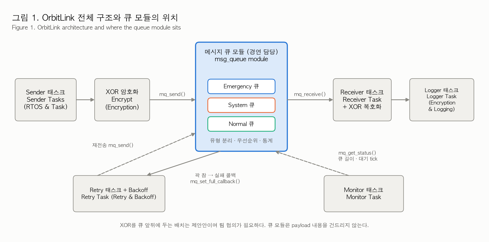
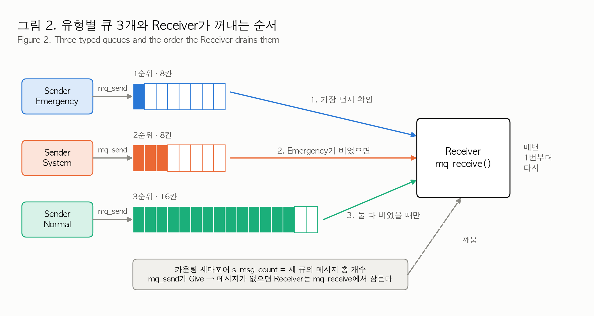
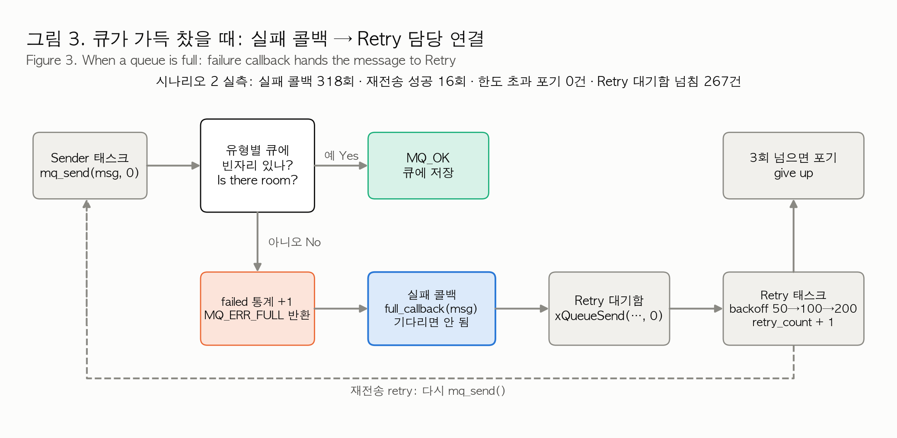
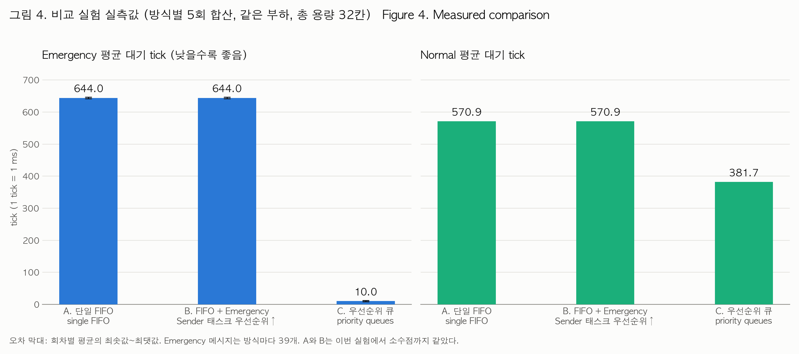

# OrbitLink 메시지 큐 파트 설명자료

**Message Queue & Priority — Presentation Notes (Korean / English)**

OS PBL Task 1, OrbitLink – Spacecraft Communication System. 담당: Message Queue Developer (메시지 유형 관리, 큐 구현, 큐 모니터링)

> 모든 수치는 `결과/시나리오_결과.txt`의 실제 실행 결과입니다. 환경: macOS(Apple Silicon), FreeRTOS POSIX 시뮬레이터, 1 tick = 1 ms 설정. All numbers are measured from the actual run saved in that file.

## 한눈에 보기 / Summary

| 항목 Item | 결과 Result |
|---|---|
| 빌드 경고 Build warnings | 0 (`-Wall -Wextra`, 커널 포함 8개 파일) |
| 자가 검사 Self-test | 13개 항목 전부 PASS |
| Emergency 평균 대기, 단일 FIFO | 644.0 tick |
| Emergency 평균 대기, FIFO + 태스크 우선순위 상향 | 644.0 tick (변화 없음 / no change) |
| Emergency 평균 대기, 우선순위 큐 | 10.0 tick (64.4배 단축 / 64.4× shorter) |

**핵심 메시지:** 태스크 우선순위를 올려도 큐 안의 순서는 바뀌지 않았습니다. 긴급 메시지를 빠르게 만든 것은 큐에서 꺼내는 순서입니다.

**Key message:** Raising a task's priority did not change the order inside the queue. What made emergency messages fast was the order in which messages are taken out of the queue.

# 1. 개념 / Concepts

## 1.1 큐 / Queue

큐는 태스크끼리 데이터를 안전하게 주고받는 통로입니다. 먼저 넣은 것이 먼저 나옵니다(FIFO). 보내는 쪽과 받는 쪽의 속도가 달라도 큐가 그 사이를 완충합니다. FreeRTOS 큐는 데이터를 복사해서 저장하므로, 보낸 쪽 변수가 사라져도 안전합니다.

A queue is a safe channel between tasks. What goes in first comes out first (FIFO). It buffers the speed difference between sender and receiver. A FreeRTOS queue stores a copy of the data, so the sender's variable may disappear safely.

## 1.2 우선순위 / Priority

이 프로젝트에는 우선순위가 두 종류 있고, 숫자의 방향도 반대입니다.

There are two kinds of priority in this project, and their numbers run in opposite directions.

| 구분 Kind | 태스크 우선순위 Task priority | 메시지 처리 우선순위 Message priority |
|---|---|---|
| 결정하는 것 Decides | 어느 태스크가 CPU를 쓰는가 Which task runs | 어떤 메시지를 먼저 꺼내는가 Which message comes out first |
| 정하는 곳 Set by | `xTaskCreate()`의 인자 | `msg_queue.c`의 꺼내는 순서 |
| 숫자 Number | 클수록 높음 Larger is higher | 작을수록 높음 Smaller is higher |
| 담당 주체 Enforced by | FreeRTOS 스케줄러 Scheduler | 우리가 만든 큐 모듈 Our queue module |

## 1.3 왜 구분해야 하는가 / Why the distinction matters

단일 FIFO 큐에 Normal 메시지 32개가 이미 쌓여 있다고 합시다. Emergency Sender 태스크의 우선순위를 아무리 높여도, 메시지를 조금 일찍 넣을 수 있을 뿐 33번째 자리에 서는 것은 같습니다. 앞의 32개가 처리되어야 차례가 옵니다. 줄을 빨리 서는 것과 줄을 앞지르는 것은 다릅니다.

Suppose 32 Normal messages are already waiting in a single FIFO. However high the Emergency Sender's priority, it only joins the line slightly earlier; it still stands behind the 32 messages. Reaching the line quickly is different from overtaking the line.

## 1.4 큐 모니터링 / Queue monitoring

평균만 보면 적체를 놓칩니다. 그래서 유형별로 현재 길이, 최대 길이(peak), 실패 횟수, 평균·최대 대기 tick을 함께 측정합니다. 길이가 용량의 80% 이상이면 Monitor가 `CONGESTED`로 표시합니다.

Averages alone can hide congestion, so the module tracks current length, peak length, failures, and average and maximum wait per type. The Monitor prints `CONGESTED` when a queue reaches 80% of its capacity.

# 2. 설계와 이유 / Design and Rationale



큐 모듈은 Sender와 Receiver 사이에 있습니다. XOR를 큐 앞뒤에 두는 배치는 제안안이며 팀 협의가 필요합니다. 큐 모듈은 payload 내용을 보지 않으므로 어느 쪽으로 정해도 코드를 바꿀 필요가 없습니다.

The queue module sits between Sender and Receiver. Placing XOR around the queue is a proposal for the team to confirm. The module never reads the payload, so either choice works without changing it.



| 설계 결정 Decision | 이유 Reason |
|---|---|
| 유형별 큐 3개 Three queues | Normal이 자기 큐를 가득 채워도 Emergency 칸은 그대로 남습니다. Normal flooding cannot take Emergency slots. |
| 매번 Emergency 큐부터 확인 Always check Emergency first | 처리 순서가 코드 한 곳에서 보장됩니다. The order is enforced in one place. |
| 카운팅 세마포어 Counting semaphore | Receiver가 폴링 없이 잠들어 있다가 어느 큐에든 메시지가 오면 깨어납니다. The Receiver sleeps without polling and wakes for any queue. |
| Queue Set 대신 세마포어 Semaphore over Queue Set | Queue Set은 도착 순서로 알려 주므로 어차피 우선순위 순서로 다시 확인해야 합니다. A Queue Set reports in arrival order, so priority must be re-checked anyway. |
| 큐 길이 8/8/16 Lengths 8/8/16 | Normal은 양이 많아 길게 잡았습니다. 측정에서 Emergency 최대 길이는 1이었으므로 8칸은 충분했습니다. Normal has more traffic; Emergency peaked at 1, so 8 was enough. |
| 실패 콜백 Failure callback | 큐 모듈은 재전송 정책을 몰라도 됩니다. Retry 담당이 독립적으로 개발할 수 있습니다. The module needs no retry policy, so Retry can be developed independently. |
| Emergency만 timeout 50 tick | 긴급 메시지는 큐가 꽉 차도 잠깐 기다려서 넣습니다. Emergency waits briefly rather than failing at once. |

**대기 시간의 정의 / Definition of wait:** `mq_send()`를 부른 시각부터 `mq_receive()`가 꺼낸 시각까지입니다. 큐가 꽉 차서 기다린 시간도 포함합니다. From calling `mq_send()` until `mq_receive()` takes the message, including any time blocked on a full queue.

# 3. API

| 함수 Function | 역할 Purpose | 반환 Returns |
|---|---|---|
| `mq_init(mode)` | 큐, 세마포어 생성 및 통계 초기화 Create and reset | `MQ_OK`, `MQ_ERR_NO_MEMORY`, `MQ_ERR_NOT_INIT` |
| `mq_deinit()` | 큐 삭제. 모드를 바꿔 다시 시작할 때 Delete queues | 없음 none |
| `mq_msg_init(msg, type, payload, len)` | 메시지 생성, id·seq·timestamp 자동 채움 Build a message | `MQ_OK`, `MQ_ERR_PARAM`, `MQ_ERR_NOT_INIT` |
| `mq_send(msg, timeout)` | 유형에 맞는 큐에 넣음 Enqueue by type | `MQ_OK`, `MQ_ERR_FULL`, `MQ_ERR_PARAM`, `MQ_ERR_NOT_INIT` |
| `mq_receive(msg, timeout)` | 가장 높은 우선순위 메시지 꺼냄 Dequeue highest priority | `MQ_OK`, `MQ_ERR_EMPTY`, `MQ_ERR_PARAM`, `MQ_ERR_NOT_INIT` |
| `mq_get_status(&status)` | 길이와 통계 조회 Read lengths and statistics | `MQ_OK`, `MQ_ERR_PARAM`, `MQ_ERR_NOT_INIT` |
| `mq_set_full_callback(cb)` | 송신 실패 콜백 등록 Register failure callback | `MQ_OK`, `MQ_ERR_NOT_INIT` |
| `mq_avg_wait_ticks(&type_status)` | 평균 대기 tick 계산 Compute average wait | `double` |

`mq_init`, `mq_deinit`을 뺀 함수는 여러 태스크에서 동시에 호출해도 안전합니다. 인터럽트 안에서는 쓸 수 없습니다. Except `mq_init` and `mq_deinit`, all functions are task-safe. They must not be called from an ISR.

# 4. 실측 결과 / Measured Results

공통 조건: Receiver가 메시지 1개를 20 tick에 처리하므로 처리량은 초당 약 50개입니다. 처리 시간은 `vTaskDelay`로 흉내 냈습니다. 표의 대기 단위는 tick입니다.

Common setup: the Receiver spends 20 ticks per message, about 50 messages per second, simulated with `vTaskDelay`. Wait values are in ticks.

## 4.0 자가 검사 / Self-test

```
넣은 순서                 : N1 N2 S1 E1 N3 E2 S2
꺼낸 순서 (우선순위 모드) : E1 E2 S1 S2 N1 N2 N3
꺼낸 순서 (단일 FIFO 모드): N1 N2 S1 E1 N3 E2 S2
```

유형 사이에서는 우선순위 순서로, 같은 유형 안에서는 먼저 들어온 순서로 나옵니다. 전체 13개 검사 항목이 통과했습니다.

Messages are ordered by priority across types and by arrival within a type. All 13 checks passed.

## 4.1 시나리오 1: 평상시 / Normal load

Sender 합계는 초당 약 15개로 처리량보다 낮습니다. 5000 tick 실행.

| 유형 Type | sent | received | failed | peak/cap | 평균 대기 Avg | 최대 대기 Max |
|---|---|---|---|---|---|---|
| Emergency | 6 | 6 | 0 | 1/8 | 0.0 | 0 |
| System | 20 | 20 | 0 | 1/8 | 1.2 | 12 |
| Normal | 48 | 48 | 0 | 1/16 | 2.0 | 19 |

**해석:** 적체가 없어서 실패가 0이고 큐 길이도 최대 1입니다. 부하가 낮을 때는 우선순위 효과가 거의 드러나지 않습니다.

**Reading:** With no backlog there are no failures and every queue peaks at 1. Priority hardly matters under light load.

## 4.2 시나리오 2: 일반 메시지 폭주 / Normal flood

처음 2000 tick 동안 Normal을 5 tick마다 보내고(초당 200개), 이후 잦아듭니다. 5000 tick 실행.

| 유형 Type | sent | received | failed | peak/cap | 평균 대기 Avg | 최대 대기 Max |
|---|---|---|---|---|---|---|
| Emergency | 4 | 4 | 0 | 1/8 | 12.5 | 19 |
| System | 17 | 17 | 0 | 1/8 | 8.3 | 26 |
| Normal | 152 | 152 | 318 | 16/16 | 244.1 | 375 |



| 실패 처리 Failure handling | 횟수 Count |
|---|---|
| 실패 콜백 호출 Callback calls | 318 |
| 재전송 성공 Retry succeeded | 16 |
| 재전송 한도 초과 포기 Gave up after limit | 0 |
| Retry 대기함 넘침으로 버려짐 Dropped, inbox full | 267 |

**해석:** Normal 큐가 16/16으로 가득 찼고, 실패 318건과 콜백 318회가 정확히 일치합니다. 그래도 Emergency와 System은 실패가 없었습니다. 다만 가짜 Retry는 16칸 대기함에서 한 건씩 처리하므로 대부분을 받아 내지 못했습니다. 실제 Retry 설계에서 다뤄야 할 부분입니다.

**Reading:** The Normal queue filled to 16/16, and the 318 failures match the 318 callback calls exactly. Emergency and System had no failures. The stand-in Retry handles one message at a time with a 16-slot inbox, so most were dropped. The real Retry design must address this.

## 4.3 시나리오 3: 폭주 중 긴급 메시지 / Emergency during a flood

Normal을 계속 5 tick마다 보내면서 Emergency를 300~500 tick 간격으로 보냅니다. 6000 tick 실행.

| 유형 Type | sent | received | failed | peak/cap | 평균 대기 Avg | 최대 대기 Max |
|---|---|---|---|---|---|---|
| Emergency | 14 | 14 | 0 | 1/8 | 7.4 | 14 |
| System | 60 | 60 | 0 | 1/8 | 11.3 | 39 |
| Normal | 242 | 242 | 957 | 16/16 | 398.5 | 455 |

**해석:** Normal 평균 대기가 Emergency의 54.2배입니다. Normal 큐가 가득 찬 상황에서도 Emergency는 평균 7.4 tick만 기다렸습니다.

**Reading:** Normal waited 54.2 times longer than Emergency on average. Even with the Normal queue full, Emergency waited only 7.4 ticks.

## 4.4 비교 실험 / Comparison experiment

시나리오 3과 같은 부하를 방식 3가지로 5회씩 반복했습니다. 회차마다 난수 씨앗을 고정해서 방식이 달라도 같은 부하가 들어갑니다. 총 큐 용량은 모두 32칸입니다. 저장 공간은 같고 처리 구조만 다릅니다.

The same load as Scenario 3 was run 5 times for each of three cases, with fixed random seeds per round. Total capacity is 32 slots in every case, so only the structure differs.

| 방식 Case | Emergency 태스크 우선순위 | Emergency 수 | 평균 대기 Avg | 회차별 평균 범위 Range | 최대 대기 Max | Normal 평균 대기 |
|---|---|---|---|---|---|---|
| A. 단일 FIFO | 3 | 39 | **644.0** | 642.0~646.8 | 656 | 570.9 |
| B. FIFO + Sender 우선순위 상향 | 4 | 39 | **644.0** | 642.0~646.8 | 656 | 570.9 |
| C. 우선순위 큐 | 3 | 39 | **10.0** | 8.2~12.1 | 19 | 381.7 |



**A와 C:** 우선순위 큐에서 Emergency 평균 대기가 644.0에서 10.0 tick으로, 64.4배 짧아졌습니다. A의 644 tick은 32칸 × 20 tick ≈ 640 tick과 일치합니다. 즉 Emergency가 줄 맨 뒤에 섰다는 뜻입니다.

**A vs C:** Priority queues cut Emergency's average wait from 644.0 to 10.0 ticks, 64.4 times shorter. The 644 ticks of case A matches 32 slots × 20 ticks ≈ 640, meaning Emergency stood at the back of the line.

**A와 B:** Emergency Sender의 태스크 우선순위가 실제로 3에서 4로 올라간 것을 실행 중에 확인했지만, 이번 조건에서 대기 시간은 소수점까지 같았습니다. 교수님이 강조하신 구분이 측정으로 확인된 것입니다.

**A vs B:** The Emergency Sender's priority was confirmed at run time to be raised from 3 to 4, yet the wait was identical under this load. This confirms by measurement the distinction the professor emphasised.

**해석할 때 주의할 점 / Cautions**

- Emergency가 A, B에서 실패 0건인 이유는 timeout 50 tick 동안 빈자리를 기다렸기 때문입니다. Emergency had no failures in A and B because it blocked for up to 50 ticks.
- C에서 Normal 대기가 짧은 이유는 Normal 큐가 16칸으로 FIFO 32칸보다 짧기 때문입니다. 우선순위 큐가 Normal에 유리하다는 뜻은 아닙니다. Normal's shorter wait in C comes from its 16-slot queue, not from any priority benefit.
- A와 B가 같은 것은 처리 시간을 `vTaskDelay`로 흉내 내 CPU 경합이 없는 이번 조건의 결과입니다. 태스크 우선순위가 언제나 무의미하다는 뜻은 아닙니다. A = B holds for this setup, where processing is simulated and there is no CPU contention. It does not mean task priority never matters.
- Emergency 표본은 방식마다 39개입니다. The sample is 39 Emergency messages per case.

# 5. 팀원 연동 / Team Integration

코드 예시 전체는 `README.md`에 있습니다. Full code samples are in `README.md`.

| 담당 Role | 쓰는 API | 할 일 What to do |
|---|---|---|
| RTOS & Task | `mq_init`, `mq_set_full_callback` | `main()`에서 스케줄러 시작 전에 호출. Call before starting the scheduler. |
| Sender 구현 | `mq_msg_init`, `mq_send` | 메시지를 만들어 보냄. 긴급은 timeout을 줌. Build and send; give Emergency a timeout. |
| Receiver 구현 | `mq_receive` | 꺼내서 처리. 순서는 모듈이 보장. Take and process; the module keeps the order. |
| Retry & Backoff | 콜백, `mq_send` | 콜백에서 복사만 하고, Retry 태스크에서 backoff 후 `retry_count`를 올려 재전송. Copy in the callback, resend from a task. |
| Encryption & Logging | `orbit_msg_t`, `mq_get_status` | `mq_send` 전에 XOR, `encrypted=1` 표시. 로그는 `vLog` 방식 사용. XOR before send; log through a safe function. |

```c
/* Retry 담당 연결 예시: 콜백은 기다리지 않고 복사만 한다 */
static void retry_on_full( const orbit_msg_t * msg )
{
    ( void ) xQueueSend( g_retry_inbox, msg, 0 );
}

mq_init( MQ_MODE_PRIORITY );
mq_set_full_callback( retry_on_full );
```

주의: 재전송할 때 `mq_msg_init()`을 다시 부르면 id와 timestamp가 바뀝니다. 기존 메시지의 `retry_count`만 올려서 `mq_send()` 하세요. When resending, do not call `mq_msg_init()` again; increase `retry_count` and call `mq_send()`.

# 6. 예상 질문 / Expected Questions

### Q1. Emergency 태스크 우선순위만 높이면 되지 않나요? / Isn't raising the Emergency task's priority enough?

**답:** 아닙니다. 태스크 우선순위는 CPU를 받는 순서이고, 메시지는 큐 안의 순서대로 나옵니다. 실험에서 우선순위를 3에서 4로 올려도 FIFO의 Emergency 평균 대기는 644.0 tick으로 같았고, 우선순위 큐는 10.0 tick이었습니다.

**A:** No. Task priority decides who gets the CPU, while messages leave in queue order. Raising priority from 3 to 4 left the FIFO wait at 644.0 ticks; the priority queues gave 10.0 ticks.

### Q2. 왜 큐를 3개로 나눴나요? 큐 하나에 앞쪽 삽입을 쓰면 안 되나요? / Why three queues rather than sending to the front of one queue?

**답:** 큐 하나를 쓰면 Normal이 칸을 다 차지해 Emergency가 들어갈 자리가 없어집니다. 또 앞쪽 삽입을 쓰면 긴급 메시지끼리 순서가 뒤집힙니다. 큐를 나누면 공간도 분리되고 유형 안의 도착 순서도 유지됩니다.

**A:** With one queue, Normal can fill every slot and leave no room for Emergency, and sending to the front reverses the order among emergencies. Separate queues isolate the space and keep arrival order within a type.

### Q3. Emergency가 계속 오면 Normal은 영영 처리되지 않나요? / Can Normal starve?

**답:** 네, 현재 구조의 한계입니다. 엄격한 우선순위라서 Emergency와 System이 처리량을 다 쓰면 Normal은 기아 상태가 됩니다. 이번 시나리오는 Emergency가 드물어서 발생하지 않았습니다. 개선안은 오래 기다린 메시지를 올려 주는 aging이나 일정 횟수마다 Normal을 하나 처리하는 방식입니다. 구현은 하지 않았습니다.

**A:** Yes, that is a limit of strict priority. If Emergency and System used all the capacity, Normal would starve. It did not occur here because Emergency is rare. Aging or serving one Normal every few messages would fix it; neither is implemented.

### Q4. Emergency 대기가 왜 0이 아닌가요? / Why is Emergency's wait not zero?

**답:** Receiver가 처리 중인 메시지는 끝날 때까지 끼어들 수 없습니다. 처리 시간이 20 tick이므로 대기는 0~20 tick 사이가 됩니다. 비교 실험의 최대값은 19, 평균은 10.0으로 이 범위와 맞습니다.

**A:** The Receiver cannot be interrupted mid-message. With 20 ticks of processing, the wait falls between 0 and 20 ticks. The measured maximum of 19 and average of 10.0 fit that range.

### Q5. 큐가 가득 차면 어떻게 되나요? / What happens when a queue is full?

**답:** `mq_send()`가 `MQ_ERR_FULL`을 돌려주고 failed 통계를 올리고 실패 콜백을 부릅니다. 시나리오 2에서 실패와 콜백이 318회로 일치했습니다. 재전송 정책은 Retry 담당이 콜백 뒤에서 결정합니다.

**A:** `mq_send()` returns `MQ_ERR_FULL`, increments the failed count and calls the callback. In Scenario 2 failures and callbacks both totalled 318. The Retry owner decides the policy behind the callback.

### Q6. 여러 태스크가 동시에 써도 안전한가요? / Is it thread-safe?

**답:** 큐 자체는 FreeRTOS가 보호합니다. 통계와 번호 발급은 크리티컬 섹션으로 보호했습니다. 메시지를 넣은 뒤에 세마포어를 Give 하므로 세마포어 개수는 항상 실제 메시지 수 이하이고, Receiver가 빈 큐를 보는 일이 없습니다. 모든 시나리오 끝에 sent와 received 일치, 실패와 콜백 횟수 일치, 유형 내 순서를 검사했고 전부 통과했습니다.

**A:** FreeRTOS protects the queues; statistics and id numbers are protected by critical sections. The semaphore is given only after a message is stored, so its count never exceeds the real message count. After every run, the program checks that sent equals received, failures equal callbacks and order within a type is kept. All passed.

### Q7. 큐 길이 8, 8, 16은 어떻게 정했나요? / How were the lengths 8, 8 and 16 chosen?

**답:** 이론으로 계산한 값은 아니고 경험적으로 정한 뒤 측정으로 확인했습니다. Emergency와 System의 최대 길이가 1이어서 8칸은 충분했습니다. Normal 16칸은 폭주 시 평균 약 400 tick의 대기를 만듭니다. 칸을 늘리면 실패는 줄지만 대기는 길어지는 교환 관계입니다.

**A:** They were picked empirically and checked by measurement, not derived by theory. Emergency and System peaked at 1, so 8 was plenty. Normal's 16 slots cause an average wait of about 400 ticks during a flood. More slots mean fewer failures but longer waits.

### Q8. 실험 결과를 믿을 수 있나요? tick이 실제 시간인가요? / Can the results be trusted, and are ticks real time?

**답:** 시뮬레이터이므로 실제 비행 하드웨어의 성능 수치가 아니라 구조의 차이를 비교한 결과입니다. 또 1 tick은 1 ms로 설정했지만 POSIX 시뮬레이터에서는 실제 시간과 정확히 같지 않습니다. 시나리오 3은 약 6500 tick에 8.1초가 걸렸습니다. 비교는 같은 씨앗, 같은 용량으로 했고, 별도 실행에서도 결과 차이가 0.1 tick 이내였습니다.

**A:** This is a simulator, so it compares structures rather than giving flight-hardware performance. One tick is set to 1 ms but does not match real time exactly: about 6500 ticks took 8.1 seconds. The comparison used the same seeds and capacity, and a separate run differed by no more than 0.1 tick.

# 7. 발표 대본 / Presentation Script (2~3분 / minutes)

## 한국어

안녕하세요. 저는 OrbitLink에서 메시지 큐 파트를 맡았습니다.

우주선에서는 일반 데이터와 선체 압력 저하 같은 긴급 메시지가 동시에 발생합니다. 그래서 제 파트의 질문은 하나입니다. 일반 메시지가 폭주하는 중에도 긴급 메시지를 어떻게 먼저 처리할 것인가입니다.

흔히 떠올리는 답은 긴급 태스크의 우선순위를 높이는 것입니다. 하지만 교수님께서 강조하셨듯이, 태스크 우선순위와 큐 안의 메시지 처리 순서는 다릅니다. 태스크 우선순위는 누가 CPU를 쓰느냐를 정하고, 메시지 순서는 큐에서 무엇을 먼저 꺼내느냐로 정해집니다.

그래서 메시지 유형별로 큐를 3개 두었습니다. Receiver는 메시지를 꺼낼 때마다 항상 Emergency 큐부터 확인하고, 그다음 System, 마지막으로 Normal을 확인합니다. 메시지가 없을 때는 카운팅 세마포어로 잠들어 있어서 CPU를 낭비하지 않습니다. 큐가 가득 차면 콜백으로 Retry 담당에게 메시지를 넘깁니다.

이것을 실험으로 확인했습니다. 저장 공간은 똑같이 32칸으로 두고, 같은 부하를 세 가지 방식으로 5번씩 돌렸습니다. 단일 FIFO에서 Emergency 평균 대기는 644 tick이었습니다. Emergency Sender의 태스크 우선순위를 3에서 4로 올려도 똑같이 644 tick이었습니다. 반면 우선순위 큐에서는 10 tick으로, 64배 이상 짧아졌습니다.

즉 줄을 빨리 서는 것과 줄을 앞지르는 것은 다르다는 것을 숫자로 확인했습니다.

한계도 있습니다. 엄격한 우선순위라서 긴급 메시지가 계속 오면 Normal이 처리되지 못할 수 있고, 처리 시간을 흉내 낸 시뮬레이터 결과입니다. 다음 단계로 Retry와 암호화를 연결하고 기아 방지 방안을 검토하겠습니다.

감사합니다.

## English

Hello. I am responsible for the message queue part of OrbitLink.

On a spacecraft, routine data and urgent alerts such as a hull pressure drop happen at the same time. So my part answers one question: how do we handle an emergency message first, even during a flood of normal traffic?

The common answer is to raise the priority of the emergency task. But as our professor emphasised, task priority and message order inside a queue are different things. Task priority decides who gets the CPU. Message order is decided by what we take out of the queue first.

So I built three queues, one per message type. Every time the Receiver takes a message, it checks the Emergency queue first, then System, and Normal last. When there is nothing to do, it sleeps on a counting semaphore, so no CPU time is wasted. When a queue is full, a callback passes the message to the Retry owner.

We tested this by experiment. We kept the storage equal at 32 slots and ran the same load five times for each of three designs. With a single FIFO, the average Emergency wait was 644 ticks. Raising the Emergency Sender's task priority from 3 to 4 still gave exactly 644 ticks. With priority queues, it dropped to 10 ticks, more than 64 times shorter.

In short, reaching the line quickly is not the same as overtaking the line, and the numbers show it.

There are limits. Strict priority could starve normal messages if emergencies never stop, and these are simulator results with simulated processing time. Next, we will connect Retry and encryption, and look at ways to prevent starvation.

Thank you.

# 8. 남은 한계 / Remaining Limits

- **Normal 기아 / Normal starvation:** 엄격한 우선순위라 aging이 없습니다. Strict priority with no aging.
- **처리 시간 모사 / Simulated processing:** `vTaskDelay`를 쓰므로 CPU 경합의 영향은 측정하지 못했습니다. CPU contention was not measured.
- **비선점 처리 / Non-preemptive processing:** Emergency도 처리 중인 메시지가 끝날 때까지 최대 약 20 tick을 기다립니다. Emergency can wait up to about 20 ticks.
- **가짜 Retry / Stand-in Retry:** 한 건씩 처리해서 시나리오 2에서 267건이 버려졌습니다. It dropped 267 messages in Scenario 2.
- **ISR 미지원 / No ISR support:** `FromISR` 버전이 없습니다. There is no `FromISR` API.
- **시뮬레이터 / Simulator:** 실제 보드에서 측정하지 않았고, macOS에서만 실행했습니다. Linux와 WSL은 확인하지 못했습니다. Run only on macOS, not on real hardware, Linux or WSL.
- **표본 수 / Sample size:** Emergency 표본이 방식마다 39개로 많지 않습니다. Only 39 Emergency samples per case.
